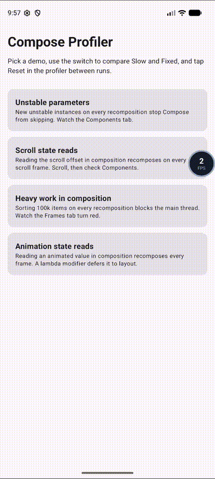

# Compose Profiler

An on-device performance overlay for **Jetpack Compose**. See frame timing, jank and recomposition counts live in your app, without opening the Android Studio profiler.

<p align="center">
  
</p>

## Features

- **Frame metrics:** FPS, total and slow frames, average and latest frame time, measured against the device's real refresh rate
- **Frame-time chart:** the last 90 frames, colored green (on time), amber (late) and red (jank)
- **Recomposition counts:** per composable, with one line of code
- **Component sizes:** in dp and px
- **Draggable overlay:** a floating FPS bubble that expands into a panel
- **Zero release overhead:** a no-op artifact with the same API keeps your release build clean

## Requirements

| | Version |
|---|---|
| Kotlin | 2.4 or newer |
| minSdk | 23 |
| UI | Jetpack Compose |

Your app's Kotlin version must be 2.4 or newer. With an older version, the build fails with an "incompatible version of Kotlin" error.

## Setup

Add the repository to `settings.gradle.kts`:

```kotlin
dependencyResolutionManagement {
    repositories {
        google()
        mavenCentral()
        maven("https://raw.githubusercontent.com/bhrapratik/ComposeProfiler/main/maven")
    }
}
```

Add the dependencies to your app module:

```kotlin
dependencies {
    debugImplementation("io.github.bhrapratik.composeprofiler:profiler:0.1.0")
    releaseImplementation("io.github.bhrapratik.composeprofiler:profiler-noop:0.1.0")
}
```

## Usage

Wrap your content:

```kotlin
setContent {
    ComposeProfiler {
        MyAppTheme { MyApp() }
    }
}
```

Track the composables you care about:

```kotlin
@Composable
fun BalanceCard(balance: Int) {
    TrackRecompositions("BalanceCard")                       // counts (re)compositions
    Card(Modifier.trackSize("BalanceCard")) { /* ... */ }    // reports measured size
}
```

Tap the FPS bubble to open the panel. Use **Reset** between test runs.

## Sample project

The [`sample`](sample) folder is a standalone Android project that uses the published library. It shows four classic Compose performance problems, each with a **Slow / Fixed** switch:

| Demo | Problem | Fix |
|---|---|---|
| Unstable parameters | new unstable instances every recomposition | `remember` |
| Scroll state reads | reading scroll offset in composition | `derivedStateOf` |
| Heavy work in composition | sorting 100k items on every recomposition | `remember(key)` |
| Animation state reads | animated value read in composition | lambda `Modifier.offset { }` |

### Run it

1. Clone the repo:
```bash
   git clone https://github.com/bhrapratik/ComposeProfiler.git
```
2. In Android Studio, open the **`sample`** folder (not the repo root).
3. Run the `app` configuration on a device or emulator.
   - **debug** build: the profiler overlay is shown
   - **release** build: uses `profiler-noop`, no overlay

Switch a demo between **Slow** and **Fixed**, then compare the frame chart and recomposition counts in the panel.

## Limitations

- Debug tool only. Use the `profiler-noop` artifact for release builds.
- Recomposition tracking is opt-in per composable.
- Measures the activity window that hosts `ComposeProfiler`. Dialogs and popups have their own windows and aren't included.

## Versions

See [CHANGELOG.md](CHANGELOG.md).

## License

Copyright 2026 Pratik Behera. Licensed under the [Apache License 2.0](LICENSE).

The library is distributed as compiled artifacts. Source is available on request.
